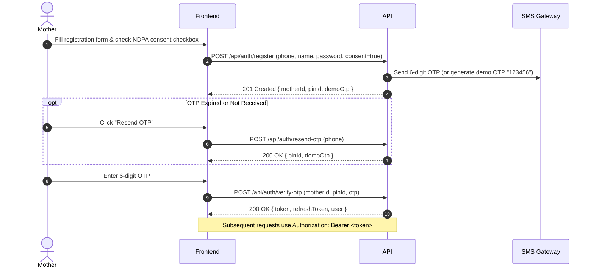

# API Contract: Antenatal & Postnatal Clinic Appointment System

This document specifies the complete API contract for the Antenatal and Postnatal Appointment System backend. All responses, error payloads, status codes, and validation rules in this contract reflect the real running Express + Knex implementation on PostgreSQL (Neon) with SQLite fallback.

---

## 1. Local Setup & Base URL

### How to Run Locally (Windows PowerShell)

```powershell
# 1. Navigate to backend directory
cd backend

# 2. Install dependencies (if not already installed)
npm install

# 3. Environment configuration
# Ensure backend/.env exists with valid DB and JWT configurations (see .env.example)

# 4. Run database migrations
npm run migrate

# 5. Seed initial clinics, staff, and demo slots
npm run seed:demo

# 6. Start the API server
npm start
```

### Base URL & Ports
- **Backend API Base URL**: `http://localhost:5000/api`
- **Health Check Endpoint**: `http://localhost:5000/api/health`
- **CORS Allowed Origins**: Configured via `CORS_ORIGIN` (defaults to `http://localhost:3000`).

---

## 2. Authentication & Authorization

### Header Format
All protected endpoints require an HTTP `Authorization` header containing a JSON Web Token:
```http
Authorization: Bearer <jwt_access_token>
```

### Token Lifecycle & Expiration
- **Access Token Lifetime**: 7 days (default, configurable via `JWT_EXPIRES_IN`). Signed using `JWT_SECRET`.
- **Refresh Token Lifetime**: 30 days (default, configurable via `JWT_REFRESH_EXPIRES_IN`). Signed using dedicated `JWT_REFRESH_SECRET`.
- **Stateless Delivery**: Both access token and refresh token are returned in the JSON response payload body (the backend does **not** set HTTP cookies). See Section 8 for client storage requirements.

### Mother Registration, OTP & Login Sequence


1. **Mother Registration (`POST /api/auth/register`)**:
   - Requires statutory consent (`consent: true`) per Nigeria Data Protection Act (NDPA) 2023 covering mother and baby data. Stores consent timestamp in database. Returns `motherId`, `pinId`, and `demoOtp` (when in demo SMS mode).
2. **Resend OTP (`POST /api/auth/resend-otp`)**:
   - Allows resending OTP for unverified mothers (`phone` required). Generates a fresh `pinId` and `demoOtp` (in demo mode).
3. **OTP Verification (`POST /api/auth/verify-otp`)**:
   - Submits `motherId`, `pinId`, and `otp`. On success, marks account as verified and returns JWT `token`, `refreshToken`, and user object.
4. **Subsequent Mother Login (`POST /api/auth/login`)**:
   - Mothers log in using phone number and password. Verified mothers receive access and refresh tokens. Unverified mothers receive `403 FORBIDDEN`.

### Staff Authentication
Staff accounts (`front_desk`, `midwife`, `doctor`, `admin`) are pre-seeded or created by an administrator. Staff log in directly via `POST /api/auth/login` using their registered phone number and password. Staff accounts do not require SMS OTP verification or statutory NDPA consent.

### Refresh Token Flow (`POST /api/auth/refresh-token`)
When an access token expires, clients submit `{ "refreshToken": "<token>" }` to obtain a fresh access token without re-prompting the user for credentials.

---

## 3. API Endpoints Reference

### Public & Utility Endpoints

#### `GET /api/health`
- **Role**: Public
- **Description**: Verifies service status and server wall-clock time.
- **Success Response (200 OK)**:
```json
{
  "success": true,
  "message": "Antenatal & Postnatal Appointment System API is running.",
  "timestamp": "2026-11-21T11:58:00.000Z"
}
```

#### `GET /api/clinic-info`
- **Role**: Public
- **Description**: Returns hospital metadata, operating days/hours, emergency unit contact, and Google Maps location link. Values are read from `backend/src/config/clinicInfo.js`.
- **Note on Demonstration Placeholders**: The hospital name, address, phone numbers, and operating days/hours are demo placeholders until verified during institutional hospital interviews. Client calendar interfaces must fetch available dates dynamically from `GET /api/clinics/:id/slots?date=YYYY-MM-DD` rather than hardcoding day-of-week filters.
- **Success Response (200 OK)**:
```json
{
  "success": true,
  "data": {
    "hospitalName": "General Hospital Lagos / Federal Medical Centre",
    "address": "123 Broad Street, Lagos Island, Lagos State, Nigeria",
    "clinicDaysAndHours": {
      "antenatal": {
        "days": [
          "Monday",
          "Tuesday",
          "Wednesday",
          "Thursday",
          "Friday"
        ],
        "hours": "08:00 - 12:00",
        "slotDurationMinutes": 20,
        "description": "Antenatal clinic sessions run Monday through Friday mornings (08:00 - 12:00) with 20-minute consultation slots."
      },
      "postnatal": {
        "days": [
          "Monday",
          "Tuesday",
          "Wednesday",
          "Thursday",
          "Friday"
        ],
        "hours": "13:00 - 16:00",
        "slotDurationMinutes": 30,
        "description": "Postnatal clinic sessions run Monday through Friday afternoons (13:00 - 16:00) with 30-minute consultation slots."
      }
    },
    "emergencyUnitNumber": "+2348001122334",
    "googleMapsUrl": "https://maps.google.com/?q=General+Hospital+Lagos+Island+Nigeria"
  }
}
```

#### `GET /api/emergency-notice`
- **Role**: Public
- **Success Response (200 OK)**:
```json
{
  "success": true,
  "message": "For emergencies, please proceed directly to the Emergency Unit. This system is for scheduled clinic visits only."
}
```

---

### Authentication Endpoints (`/api/auth`)

#### `POST /api/auth/register`
- **Role**: Public
- **Body**:
  - `phone` (string, required): Nigerian phone number (e.g. `08012345678` or `+2348012345678`)
  - `name` (string, required): Full name
  - `password` (string, required): Minimum 6 characters
  - `consent` (boolean, required): Must be strictly `true` (NDPA 2023 requirement)
  - `hospital_id` (string, optional): Hospital folder/ID number
  - `hmo_number` (string, optional): HMO / NHIA enrollment number
- **Success Response (201 Created)**:
```json
{
  "success": true,
  "message": "Registration successful. Please enter the OTP sent to your phone.",
  "data": {
    "motherId": "b1b7021b-417c-473d-82d0-a0bc5e510825",
    "pinId": "demo-pin-1732185934000",
    "demoOtp": "123456"
  }
}
```
- **Error Codes**: `VALIDATION_ERROR` (422), `CONFLICT` (409).

#### `POST /api/auth/verify-otp`
- **Role**: Public
- **Body**:
  - `motherId` (string/UUID, required)
  - `pinId` (string, required)
  - `otp` (string, required): 6-digit code (e.g. `123456` in demo mode)
- **Success Response (200 OK)**:
```json
{
  "success": true,
  "message": "Phone number verified successfully.",
  "data": {
    "token": "eyJhbGciOiJIUzI1NiIsInR5c...",
    "refreshToken": "eyJhbGciOiJIUzI1NiIsInR5c...",
    "user": {
      "id": "b1b7021b-417c-473d-82d0-a0bc5e510825",
      "name": "Amina Bello",
      "phone": "+2348012345678",
      "role": "mother",
      "is_verified": true
    }
  }
}
```
- **Error Codes**: `VALIDATION_ERROR` (422), `OTP_INVALID` (400), `NOT_FOUND` (404).

#### `POST /api/auth/resend-otp`
- **Role**: Public
- **Body**:
  - `phone` (string, required): Registered phone number of an unverified mother
- **Success Response (200 OK)**:
```json
{
  "success": true,
  "message": "OTP resent successfully.",
  "data": {
    "pinId": "demo-pin-1795262319661",
    "demoOtp": "123456"
  }
}
```
- **Error Codes**: `VALIDATION_ERROR` (422), `NOT_FOUND` (404), `BAD_REQUEST` (400, if already verified).

#### `POST /api/auth/login`
- **Role**: Public
- **Body**:
  - `phone` (string, required): Registered phone number
  - `password` (string, required)
- **Success Response (200 OK)**:
```json
{
  "success": true,
  "message": "Login successful.",
  "data": {
    "token": "eyJhbGciOiJIUzI1NiIsInR5c...",
    "refreshToken": "eyJhbGciOiJIUzI1NiIsInR5c...",
    "user": {
      "id": "ff3280aa-8a8a-47ee-9706-23ca57c9a2ae",
      "name": "Dr. Adebayo",
      "phone": "+2340000000002",
      "role": "doctor"
    }
  }
}
```
- **Error Codes**: `VALIDATION_ERROR` (422), `UNAUTHORIZED` (401), `FORBIDDEN` (403, unverified mother).

#### `POST /api/auth/refresh-token`
- **Role**: Public
- **Body**:
  - `refreshToken` (string, required)
- **Success Response (200 OK)**:
```json
{
  "success": true,
  "data": {
    "token": "eyJhbGciOiJIUzI1NiIsInR5c..."
  }
}
```
- **Error Codes**: `VALIDATION_ERROR` (422), `UNAUTHORIZED` (401).

---

### Clinics & Schedule Slots (`/api/clinics`)

#### `GET /api/clinics`
- **Role**: Public
- **Success Response (200 OK)**:
```json
{
  "success": true,
  "data": [
    {
      "id": "ff3280aa-8a8a-47ee-9706-23ca57c9a2ae",
      "name": "Antenatal Clinic",
      "slot_duration_min": 20,
      "walkin_reserve_pct": 0.2
    },
    {
      "id": "7e6ad70c-074e-4276-a97f-9f3922aafa3b",
      "name": "Postnatal Clinic",
      "slot_duration_min": 30,
      "walkin_reserve_pct": 0.2
    }
  ]
}
```

#### `GET /api/clinics/:id`
- **Role**: Public
- **Success Response (200 OK)**:
```json
{
  "success": true,
  "data": {
    "id": "ff3280aa-8a8a-47ee-9706-23ca57c9a2ae",
    "name": "Antenatal Clinic",
    "slot_duration_min": 20,
    "walkin_reserve_pct": 0.2
  }
}
```

#### `POST /api/clinics`
- **Role**: `admin`
- **Body**:
  - `name` (string, required): Clinic name
  - `slot_duration_min` (integer, optional): 5 to 120 (default 20)
  - `walkin_reserve_pct` (float, optional): 0 to 1 (default 0.2)
- **Success Response (201 Created)**:
```json
{
  "success": true,
  "message": "Clinic created.",
  "data": {
    "id": "c4d5e6f7-8901-2345-6789-0123456789ab",
    "name": "Immunization Clinic",
    "slot_duration_min": 15,
    "walkin_reserve_pct": 0.2
  }
}
```

#### `PUT /api/clinics/:id`
- **Role**: `admin`
- **Body**:
  - `name` (string, optional)
  - `slot_duration_min` (integer, optional): 5 to 120
  - `walkin_reserve_pct` (float, optional): 0 to 1
- **Success Response (200 OK)**:
```json
{
  "success": true,
  "message": "Clinic updated.",
  "data": {
    "id": "ff3280aa-8a8a-47ee-9706-23ca57c9a2ae",
    "name": "Antenatal Clinic",
    "slot_duration_min": 20,
    "walkin_reserve_pct": 0.2
  }
}
```

#### `GET /api/clinics/:id/slots?date=YYYY-MM-DD`
- **Role**: Public (Optional Auth: filters walk-ins for mothers/unauthenticated callers)
- **Query**:
  - `date` (string, required): Format `YYYY-MM-DD`
- **Rules**:
  - Unauthenticated callers and mothers see **only non-walkin slots** whose start time has not passed in Nigeria (`Africa/Lagos`).
  - Staff (`front_desk`, `admin`, `midwife`, `doctor`) see **both regular and walk-in slots**, and can view today's ongoing slots that have not ended.
- **Success Response (200 OK)**:
```json
{
  "success": true,
  "data": {
    "clinicId": "ff3280aa-8a8a-47ee-9706-23ca57c9a2ae",
    "date": "2026-11-22",
    "availableSlots": [
      {
        "id": "4d6bbb73-4b20-4554-9872-443894aa0a74",
        "start_time": "08:00:00",
        "end_time": "08:20:00",
        "is_walkin": false,
        "staff_id": "9d9d522b-5937-4f8e-8793-b62d24c82dee",
        "staffName": "Dr. Adebayo"
      }
    ],
    "totalAvailable": 1
  }
}
```

---

### Appointments (`/api/appointments`)

#### `POST /api/appointments`
- **Role**: `mother`, `front_desk`, `admin`, `midwife`, `doctor`
- **Body**:
  - `clinic_id` (string/UUID, required)
  - `slot_id` (string/UUID, required)
  - `booking_type` (string, optional): `"mother"`, `"baby"`, or `"both"` (default `"mother"`)
    - Antenatal Clinic accepts `"mother"` only.
    - Postnatal Clinic accepts `"mother"`, `"baby"`, or `"both"`.
    - Any mismatch throws `400 BOOKING_TYPE_INVALID`.
  - `baby_ids` (array of UUIDs, optional): Required when `booking_type` is `"baby"` or `"both"`. All babies must belong to the mother.
  - `mother_id` (string/UUID, optional): Required when staff books on behalf of a mother; ignored when mother books for herself.
- **Success Response (201 Created)**:
```json
{
  "success": true,
  "message": "Appointment booked successfully.",
  "data": {
    "id": "e8df483f-67d7-4be7-b35f-eb59d9f5aa1a",
    "mother_id": "b1b7021b-417c-473d-82d0-a0bc5e510825",
    "clinic_id": "ff3280aa-8a8a-47ee-9706-23ca57c9a2ae",
    "slot_id": "4d6bbb73-4b20-4554-9872-443894aa0a74",
    "status": "booked",
    "booking_type": "mother",
    "booked_at": "2026-11-21T10:30:15.000Z",
    "reminder_24h_sent": false,
    "reminder_2h_sent": false
  }
}
```
- **Error Codes**: `BOOKING_TYPE_INVALID` (400), `SLOT_PAST` (400), `SLOT_RESERVED` (400), `SLOT_TAKEN` (409), `OVERLAP` (409), `VALIDATION_ERROR` (422).

#### `POST /api/appointments/follow-up`
- **Role**: `midwife`, `doctor`, `front_desk`, `admin`
- **Description**: Clinical staff books a follow-up appointment for a mother during or after consultation.
- **Body**:
  - `mother_id` (string/UUID, required)
  - `clinic_id` (string/UUID, required)
  - `slot_id` (string/UUID, required)
  - `booking_type` (string, optional): `"mother"`, `"baby"`, or `"both"`
  - `baby_ids` (array of UUIDs, optional): Required for `"baby"` or `"both"`
- **Success Response (201 Created)**:
```json
{
  "success": true,
  "message": "Follow-up appointment booked.",
  "data": {
    "id": "a9101112-3456-7890-abcd-ef0123456789",
    "mother_id": "ce0bb2e3-a8f2-453b-89e6-921a8981b5fa",
    "clinic_id": "7e6ad70c-074e-4276-a97f-9f3922aafa3b",
    "slot_id": "b8101112-3456-7890-abcd-ef0123456789",
    "status": "booked",
    "booking_type": "baby",
    "booked_at": "2026-11-21T11:45:00.000Z"
  }
}
```
- **Error Codes**: `BOOKING_TYPE_INVALID` (400), `SLOT_PAST` (400), `SLOT_TAKEN` (409), `OVERLAP` (409).

#### `GET /api/appointments`
- **Role**: Any Authenticated User
- **Query**:
  - `view` (string, optional): `"upcoming"` (default) or `"past"`
  - `status` (string, optional): Filter by appointment status
  - `date` (string, optional): Filter by date (`YYYY-MM-DD`)
  - `clinic_id` (string, optional): Filter by clinic UUID
- **Behavior**:
  - Mothers see only their own appointments.
  - Staff see appointments matching the query filters.
  - Returns appointment objects including `late_arrival` (boolean) and linked `babies` array.
  - `?view=past` returns `completed`, `cancelled`, and `no_show` appointments, ordered newest first.
  - Appointments are **never deleted**; there is no delete endpoint.
- **Success Response (200 OK)**:
```json
{
  "success": true,
  "data": [
    {
      "id": "fd6fecc4-5081-496b-a87b-3b07fac31aa0",
      "mother_id": "733f2137-1db1-4534-9153-dc210ef1b444",
      "clinic_id": "ff3280aa-8a8a-47ee-9706-23ca57c9a2ae",
      "staff_id": "70d3ed92-1c9a-4906-995e-0b2e875d253f",
      "slot_id": "60d93bc9-7123-47b4-92d2-472b43008b4d",
      "status": "booked",
      "booking_type": "both",
      "queue_number": null,
      "booked_at": "2026-11-21T11:17:49.178Z",
      "checked_in_at": null,
      "reminder_24h_sent": true,
      "reminder_2h_sent": false,
      "created_at": "2026-11-21T11:17:48.084Z",
      "updated_at": "2026-11-21T11:17:48.084Z",
      "late_arrival": false,
      "slot_date": "2026-11-22",
      "start_time": "08:20:00",
      "end_time": "08:40:00",
      "clinic_name": "Antenatal Clinic",
      "staff_name": "Nurse Fatima",
      "babies": [
        {
          "id": "bfb19af6-1b95-4e6d-afa9-67d890bd6ef3",
          "name": "Smoke Test Baby"
        }
      ]
    }
  ]
}
```

#### `GET /api/appointments/:id`
- **Role**: `mother` (ownership enforced), `front_desk`, `midwife`, `doctor`, `admin`
- **Rules**: Mothers receive `403 FORBIDDEN` if attempting to view another patient's appointment.
- **Success Response (200 OK)**:
```json
{
  "success": true,
  "data": {
    "id": "fd6fecc4-5081-496b-a87b-3b07fac31aa0",
    "mother_id": "733f2137-1db1-4534-9153-dc210ef1b444",
    "clinic_id": "ff3280aa-8a8a-47ee-9706-23ca57c9a2ae",
    "staff_id": "70d3ed92-1c9a-4906-995e-0b2e875d253f",
    "slot_id": "60d93bc9-7123-47b4-92d2-472b43008b4d",
    "status": "booked",
    "booking_type": "both",
    "queue_number": null,
    "booked_at": "2026-11-21T11:17:49.178Z",
    "checked_in_at": null,
    "reminder_24h_sent": true,
    "reminder_2h_sent": false,
    "created_at": "2026-11-21T11:17:48.084Z",
    "updated_at": "2026-11-21T11:17:48.084Z",
    "late_arrival": false,
    "slot_date": "2026-11-22",
    "start_time": "08:20:00",
    "end_time": "08:40:00",
    "clinic_name": "Antenatal Clinic",
    "staff_name": "Nurse Fatima",
    "babies": [
      {
        "id": "bfb19af6-1b95-4e6d-afa9-67d890bd6ef3",
        "name": "Smoke Test Baby"
      }
    ]
  }
}
```

#### `PUT /api/appointments/:id/reschedule`
- **Role**: `mother` (ownership enforced), `front_desk`, `admin`
- **Body**:
  - `new_slot_id` (string/UUID, required)
  - `booking_type` (string, optional)
  - `baby_ids` (array of UUIDs, optional)
- **Rules**:
  - Subject to the 4-hour cutoff rule based on `Africa/Lagos` time (`CUTOFF_PASSED`).
  - Cannot reschedule into past slots (`SLOT_PAST`).
  - Mothers cannot reschedule into walk-in slots (`SLOT_RESERVED`).
  - Clinic booking type rules apply (`BOOKING_TYPE_INVALID`).
  - Atomic transfer executed in a single transaction with mother row locking.
- **Success Response (200 OK)**:
```json
{
  "success": true,
  "message": "Appointment rescheduled successfully."
}
```
- **Error Codes**: `CUTOFF_PASSED` (400), `SLOT_PAST` (400), `SLOT_RESERVED` (400), `BOOKING_TYPE_INVALID` (400), `SLOT_TAKEN` (409), `OVERLAP` (409), `FORBIDDEN` (403).

#### `PUT /api/appointments/:id/cancel`
- **Role**: `mother` (ownership enforced), `front_desk`, `admin`
- **Body**:
  - `reason` (string, optional)
- **Rules**:
  - Subject to 4-hour cutoff rule based on `Africa/Lagos` time (`CUTOFF_PASSED`).
  - Sets `status: "cancelled"`, freeing the slot for other mothers.
- **Success Response (200 OK)**:
```json
{
  "success": true,
  "message": "Appointment cancelled successfully."
}
```
- **Error Codes**: `CUTOFF_PASSED` (400), `BAD_REQUEST` (400, if already completed/cancelled), `FORBIDDEN` (403).

#### `POST /api/appointments/:id/checkin`
- **Role**: `front_desk`, `admin`
- **Behavior & Grace Period Rules**:
  - Allowed on the appointment's scheduled date only (`Africa/Lagos` time) when status is `booked`.
  - Check-in on any different date, or when the appointment is cancelled or already checked in, is refused with `400 CHECKIN_NOT_ALLOWED`.
  - **Grace Period (`LATE_GRACE_MINUTES`, default 15)**:
    - Up to `start_time + grace`: Normal check-in with `late_arrival: false`.
    - After `start_time + grace`: Still accepted, but flagged with `late_arrival: true`.
    - Late mothers join the END of the queue based on their check-in time (`checked_in_at`), never displacing mothers who checked in earlier.
- **Success Response (200 OK)**:
```json
{
  "success": true,
  "message": "Patient checked in.",
  "data": {
    "appointmentId": "e8df483f-67d7-4be7-b35f-eb59d9f5aa1a",
    "queueNumber": "ANC-001",
    "status": "checked_in",
    "checked_in_at": "2026-11-21T10:45:00.000Z",
    "late_arrival": false
  }
}
```
- **Error Codes**: `CHECKIN_NOT_ALLOWED` (400), `NOT_FOUND` (404), `FORBIDDEN` (403), `UNAUTHORIZED` (401).

#### `PUT /api/appointments/:id/status`
- **Role**: `front_desk`, `midwife`, `doctor`, `admin`
- **Body**:
  - `status` (string, required): One of `"waiting"`, `"in_consultation"`, `"completed"`, `"no_show"`
- **Role & Grace Period Rules**:
  - **Front Desk Staff (`front_desk`)**: May set status to `"no_show"` only. Attempts to set `"waiting"`, `"in_consultation"`, or `"completed"` are refused with `403 FORBIDDEN`.
  - **Midwives & Doctors (`midwife`, `doctor`)**: May set `"waiting"`, `"in_consultation"`, `"completed"`, and `"no_show"`.
  - **Administrators (`admin`)**: May set any of the 4 statuses.
  - **Marking `no_show`**: Allowed only for appointments never checked in (status must be `booked`), and only after `start_time + LATE_GRACE_MINUTES` has passed in `Africa/Lagos` time. Before that grace expires, refused with `400 NO_SHOW_TOO_EARLY`.
  - Appointments already checked in cannot be marked as `no_show` (`400 BAD_REQUEST`).
- **Success Response (200 OK)**:
```json
{
  "success": true,
  "message": "Appointment status updated to completed."
}
```
- **Error Codes**: `NO_SHOW_TOO_EARLY` (400), `BAD_REQUEST` (400), `FORBIDDEN` (403), `NOT_FOUND` (404), `UNAUTHORIZED` (401).

---

### Queue Management (`/api/queue`)

#### `GET /api/queue/today/:clinicId`
- **Role**: Any Authenticated User
- **Privacy Rule**:
  - **Mothers**: Patient names (`mother_name`) are stripped. Returns ticket number, status, timestamp, `late_arrival` flag, and the ticket currently being served.
  - **Staff**: Full queue details including patient names, appointment details, and `late_arrival` flag.
- **Success Response for Mothers (200 OK)**:
```json
{
  "success": true,
  "data": {
    "clinicId": "ff3280aa-8a8a-47ee-9706-23ca57c9a2ae",
    "date": "2026-11-21",
    "queue": [
      {
        "queue_number": "ANC-001",
        "status": "checked_in",
        "checked_in_at": "2026-11-21T10:30:00.000Z",
        "late_arrival": false
      }
    ],
    "totalInQueue": 1,
    "currentlyServing": null
  }
}
```

#### `GET /api/queue/position/:appointmentId`
- **Role**: `mother` (ownership enforced), `front_desk`, `midwife`, `doctor`, `admin`
- **Success Response (200 OK)**:
```json
{
  "success": true,
  "data": {
    "queueNumber": "ANC-001",
    "position": 1,
    "status": "checked_in",
    "late_arrival": false,
    "message": "You are number 1 in the queue."
  }
}
```

---

### Mother & Baby Management (`/api/mothers`, `/api/babies`)

#### `GET /api/mothers/profile`
- **Role**: `mother`
- **Success Response (200 OK)**:
```json
{
  "success": true,
  "data": {
    "id": "ce0bb2e3-a8f2-453b-89e6-921a8981b5fa",
    "name": "Mrs. Amina Bello",
    "phone": "+2348012345678",
    "hospital_id": "HOSP-00123",
    "hmo_number": "HMO-456",
    "created_at": "2026-11-21T08:55:55.926Z",
    "babies": [
      {
        "id": "09acf693-4082-4757-83cf-afdb1afcaf19",
        "name": "Baby Bello",
        "date_of_birth": "2024-11-01",
        "sex": "female",
        "created_at": "2026-11-21T08:55:56.081Z"
      }
    ]
  }
}
```

#### `PUT /api/mothers/profile`
- **Role**: `mother`
- **Body**:
  - `name` (string, optional)
  - `hospital_id` (string, optional)
  - `hmo_number` (string, optional)
- **Success Response (200 OK)**:
```json
{
  "success": true,
  "message": "Profile updated successfully.",
  "data": {
    "id": "ce0bb2e3-a8f2-453b-89e6-921a8981b5fa",
    "name": "Mrs. Amina Bello",
    "phone": "+2348012345678",
    "hospital_id": "HOSP-00123",
    "hmo_number": "HMO-456",
    "created_at": "2026-11-21T08:55:55.926Z"
  }
}
```

#### `GET /api/mothers/:id`
- **Role**: `front_desk`, `midwife`, `doctor`, `admin`
- **Description**: Returns mother profile and babies. Automatically writes an audit log entry (`STAFF_VIEW_MOTHER_PROFILE`).
- **Success Response (200 OK)**:
```json
{
  "success": true,
  "data": {
    "id": "ce0bb2e3-a8f2-453b-89e6-921a8981b5fa",
    "name": "Mrs. Amina Bello",
    "phone": "+2348012345678",
    "hospital_id": "HOSP-00123",
    "hmo_number": "HMO-456",
    "created_at": "2026-11-21T08:55:55.926Z",
    "babies": [
      {
        "id": "09acf693-4082-4757-83cf-afdb1afcaf19",
        "name": "Baby Bello",
        "date_of_birth": "2024-11-01",
        "sex": "female"
      }
    ]
  }
}
```

#### `POST /api/babies`
- **Role**: `mother`
- **Body**:
  - `name` (string, required): Baby name
  - `date_of_birth` (string/date, required): Format `YYYY-MM-DD`
  - `sex` (string, required): `"male"` or `"female"`
- **Success Response (201 Created)**:
```json
{
  "success": true,
  "message": "Baby registered.",
  "data": {
    "id": "09acf693-4082-4757-83cf-afdb1afcaf19",
    "mother_id": "ce0bb2e3-a8f2-453b-89e6-921a8981b5fa",
    "name": "Baby Bello",
    "date_of_birth": "2024-11-01",
    "sex": "female",
    "created_at": "2026-11-21T08:55:56.081Z"
  }
}
```

#### `GET /api/babies`
- **Role**: `mother`
- **Success Response (200 OK)**:
```json
{
  "success": true,
  "data": [
    {
      "id": "09acf693-4082-4757-83cf-afdb1afcaf19",
      "name": "Baby Bello",
      "date_of_birth": "2024-11-01",
      "sex": "female",
      "created_at": "2026-11-21T08:55:56.081Z"
    }
  ]
}
```

#### `PUT /api/babies/:id`
- **Role**: `mother` (ownership enforced)
- **Body**:
  - `name` (string, optional)
  - `date_of_birth` (string/date, optional)
  - `sex` (string, optional): `"male"` or `"female"`
- **Success Response (200 OK)**:
```json
{
  "success": true,
  "message": "Baby updated.",
  "data": {
    "id": "09acf693-4082-4757-83cf-afdb1afcaf19",
    "name": "Baby Zainab Bello",
    "date_of_birth": "2024-11-01",
    "sex": "female"
  }
}
```

#### `DELETE /api/babies/:id`
- **Role**: `mother` (ownership enforced)
- **Success Response (200 OK)**:
```json
{
  "success": true,
  "message": "Baby profile deleted."
}
```

---

### Admin Operations (`/api/admin`)

#### `POST /api/admin/slots/generate`
- **Role**: `admin`
- **Body**:
  - `clinic_id` (string/UUID, required)
  - `from_date` (string/date, required): Format `YYYY-MM-DD` (cannot be in the past)
  - `to_date` (string/date, required): Format `YYYY-MM-DD` (range <= 31 days)
  - `start_time` (string, required): Format `HH:MM` (e.g. `"08:00"`)
  - `end_time` (string, required): Format `HH:MM` (e.g. `"12:00"`)
  - `weekdays` (array of integers 0-6, optional): Days to generate (default `[1, 2, 3, 4, 5]`, where 0=Sunday, 1=Monday)
  - `staff_id` (string/UUID, optional)
- **Behavior**:
  - Uses clinic's `slot_duration_min`.
  - Spreads walk-in slots (~20%, e.g. `index % 5 === 2`) evenly through each day, not bunched at the end.
  - Skips slots that already exist (idempotent, safe to run twice).
  - Writes an audit log entry (`GENERATE_SLOTS`).
- **Success Response (200 OK)**:
```json
{
  "success": true,
  "message": "Slots generated successfully.",
  "data": {
    "clinic_id": "ff3280aa-8a8a-47ee-9706-23ca57c9a2ae",
    "from_date": "2026-12-01",
    "to_date": "2026-12-02",
    "created": 6,
    "skipped": 0
  }
}
```
- **Error Codes**: `BAD_REQUEST` (400, for past dates or ranges > 31 days), `NOT_FOUND` (404), `FORBIDDEN` (403).

#### `GET /api/admin/reports/appointments`
- **Role**: `admin`
- **Query**:
  - `date` (string, optional): Specific date `YYYY-MM-DD` (defaults to today)
- **Success Response (200 OK)**:
```json
{
  "success": true,
  "data": {
    "period": "daily",
    "date": "2026-11-21",
    "clinics": [
      {
        "clinic_name": "Antenatal Clinic",
        "total_appointments": 6,
        "completed": 2,
        "no_shows": 0,
        "cancelled": 4,
        "upcoming": 0
      }
    ]
  }
}
```

#### `GET /api/admin/reports/no-shows`
- **Role**: `admin`
- **Query**:
  - `from` (string, optional): `YYYY-MM-DD`
  - `to` (string, optional): `YYYY-MM-DD`
- **Success Response (200 OK)**:
```json
{
  "success": true,
  "data": [
    {
      "clinic_name": "Antenatal Clinic",
      "total_appointments": 8,
      "no_shows": 0,
      "no_show_rate": 0
    }
  ]
}
```

#### `GET /api/admin/reports/clinic-load`
- **Role**: `admin`
- **Query**:
  - `date` (string, optional): `YYYY-MM-DD` (defaults to today)
- **Success Response (200 OK)**:
```json
{
  "success": true,
  "data": {
    "date": "2026-11-21",
    "clinics": [
      {
        "clinic_name": "Antenatal Clinic",
        "total_slots": 15,
        "booked_slots": 2,
        "available_slots": 13,
        "occupancy_pct": 13.3
      },
      {
        "clinic_name": "Postnatal Clinic",
        "total_slots": 6,
        "booked_slots": 0,
        "available_slots": 6,
        "occupancy_pct": 0
      }
    ]
  }
}
```

#### `POST /api/admin/block-date`
- **Role**: `admin`
- **Body**:
  - `clinic_id` (string/UUID, required)
  - `date` (string/date, required): Format `YYYY-MM-DD`
  - `reason` (string, optional)
- **Success Response (200 OK)**:
```json
{
  "success": true,
  "message": "6 slots blocked on 2026-12-25."
}
```

#### `DELETE /api/admin/block-date/:clinicId/:date`
- **Role**: `admin`
- **Params**:
  - `clinicId` (string/UUID, required)
  - `date` (string/date, required): Format `YYYY-MM-DD`
- **Success Response (200 OK)**:
```json
{
  "success": true,
  "message": "6 slots unblocked."
}
```

#### `POST /api/admin/cancel-session`
- **Role**: `admin`
- **Body**:
  - `clinic_id` (string/UUID, required)
  - `date` (string/date, required): Format `YYYY-MM-DD`
  - `reason` (string, required): Explanation sent via SMS to affected mothers
- **Success Response (200 OK)**:
```json
{
  "success": true,
  "message": "Session cancelled. 4 appointment(s) cancelled and patients notified.",
  "data": {
    "clinic_id": "ff3280aa-8a8a-47ee-9706-23ca57c9a2ae",
    "date": "2026-11-25",
    "reason": "Facility renovation",
    "cancelled_appointments": 4
  }
}
```

#### `GET /api/admin/staff`
- **Role**: `admin`
- **Success Response (200 OK)**:
```json
{
  "success": true,
  "data": [
    {
      "id": "e30b148d-8d00-475c-8956-e78166fb1ef2",
      "name": "Admin User",
      "role": "admin",
      "phone": "+2340000000001",
      "created_at": "2026-11-21T08:55:55.294Z"
    },
    {
      "id": "9d9d522b-5937-4f8e-8793-b62d24c82dee",
      "name": "Dr. Adebayo",
      "role": "doctor",
      "phone": "+2340000000002",
      "created_at": "2026-11-21T08:55:55.294Z"
    },
    {
      "id": "0bbef56f-086b-41af-bfb1-74487fc23bb6",
      "name": "Mr. Chukwu",
      "role": "front_desk",
      "phone": "+2340000000004",
      "created_at": "2026-11-21T08:55:55.294Z"
    },
    {
      "id": "70d3ed92-1c9a-4906-995e-0b2e875d253f",
      "name": "Nurse Fatima",
      "role": "midwife",
      "phone": "+2340000000003",
      "created_at": "2026-11-21T08:55:55.294Z"
    }
  ]
}
```

#### `POST /api/admin/staff`
- **Role**: `admin`
- **Body**:
  - `name` (string, required)
  - `role` (string, required): One of `"front_desk"`, `"midwife"`, `"doctor"`, `"admin"`
  - `phone` (string, required)
  - `password` (string, required): Minimum 6 characters
- **Success Response (201 Created)**:
```json
{
  "success": true,
  "message": "Staff account created.",
  "data": {
    "id": "8582b717-710f-4eda-ba6b-de55f7b4f562",
    "name": "Front Desk Officer",
    "role": "front_desk",
    "phone": "+2348000000003",
    "created_at": "2026-11-21T09:43:02.984Z"
  }
}
```

#### `PUT /api/admin/staff/:id`
- **Role**: `admin`
- **Body**:
  - `name` (string, optional)
  - `role` (string, optional): One of `"front_desk"`, `"midwife"`, `"doctor"`, `"admin"`
  - `phone` (string, optional)
  - `password` (string, optional): Minimum 6 characters
- **Success Response (200 OK)**:
```json
{
  "success": true,
  "message": "Staff updated.",
  "data": {
    "id": "8582b717-710f-4eda-ba6b-de55f7b4f562",
    "name": "Senior Front Desk Officer",
    "role": "front_desk",
    "phone": "+2348000000003",
    "created_at": "2026-11-21T09:43:02.984Z"
  }
}
```

#### `GET /api/admin/audit-logs`
- **Role**: `admin`
- **Query**:
  - `action` (string, optional): Filter by action (e.g. `LOGIN_SUCCESS`, `BOOK_APPOINTMENT`)
  - `user_id` (string, optional): Filter by user UUID
  - `limit` (integer, optional): Default 50
  - `offset` (integer, optional): Default 0
- **Success Response (200 OK)**:
```json
{
  "success": true,
  "data": [
    {
      "id": "d9fa39ba-4940-4b6a-9218-781fea81da1f",
      "user_id": "ce0bb2e3-a8f2-453b-89e6-921a8981b5fa",
      "action": "LOGIN_SUCCESS",
      "details": {
        "role": "mother",
        "phone": "+2348012345678"
      },
      "created_at": "2026-11-21T11:58:00.566Z"
    },
    {
      "id": "524c58a4-525f-438c-bfab-dd94039c7ed3",
      "user_id": "9d9d522b-5937-4f8e-8793-b62d24c82dee",
      "action": "LOGIN_SUCCESS",
      "details": {
        "role": "doctor",
        "phone": "+2340000000002"
      },
      "created_at": "2026-11-21T11:57:59.510Z"
    }
  ]
}
```

---

## 4. Error Response Schema & Error Codes

### Standard Error Response Shape
Every API error response follows this exact structure:

```json
{
  "success": false,
  "error": {
    "code": "SLOT_TAKEN",
    "message": "This slot is already booked. Please choose another."
  },
  "message": "This slot is already booked. Please choose another."
}
```

For validation failures (`422 Unprocessable Entity`), an additional `errors` array is included:
```json
{
  "success": false,
  "error": {
    "code": "VALIDATION_ERROR",
    "message": "Validation failed.",
    "details": [
      {
        "type": "field",
        "msg": "Consent under the Nigeria Data Protection Act 2023 is required.",
        "path": "consent",
        "location": "body"
      }
    ]
  },
  "message": "Validation failed.",
  "errors": [
    {
      "type": "field",
      "msg": "Consent under the Nigeria Data Protection Act 2023 is required.",
      "path": "consent",
      "location": "body"
    }
  ]
}
```

### Complete Error Code Table

| Error Code | HTTP Status | Description & Trigger Cause |
|---|---|---|
| `VALIDATION_ERROR` | 422 | Request body or query parameters failed validation checks (e.g. invalid phone format, password too short, missing consent). |
| `UNAUTHORIZED` | 401 | Missing, malformed, or expired JWT bearer token; or invalid login credentials. |
| `FORBIDDEN` | 403 | Authenticated user lacks permission (e.g. mother accessing another mother's appointment, unverified mother login, front desk setting consultation status). |
| `NOT_FOUND` | 404 | Requested route, clinic, slot, mother, baby, or appointment does not exist. |
| `SLOT_TAKEN` | 409 | The slot has already been claimed by another patient (enforced by application lock and DB unique partial index). |
| `OVERLAP` | 409 | The mother already holds another active appointment during the overlapping time window on that date. |
| `BOOKING_TYPE_INVALID` | 400 | The booking type is invalid for the clinic (e.g. `baby` or `both` sent to Antenatal Clinic), or `baby_ids` are missing or do not belong to the mother. |
| `SLOT_RESERVED` | 400 | A mother attempted to book or reschedule into a walk-in reserved slot (`is_walkin: true`). |
| `SLOT_PAST` | 400 | The slot's start time (for mothers) or end time (for staff) has already passed in Nigerian wall-clock time (`Africa/Lagos`). |
| `CUTOFF_PASSED` | 400 | An attempt was made to cancel or reschedule an appointment less than 4 hours before its scheduled start time. |
| `CHECKIN_NOT_ALLOWED` | 400 | Check-in attempted on a date other than the appointment's scheduled date, or appointment is cancelled or already checked in. |
| `NO_SHOW_TOO_EARLY` | 400 | Attempted to mark an appointment as `no_show` before `start_time + LATE_GRACE_MINUTES` has passed in Nigerian time. |
| `OTP_INVALID` | 400 | The submitted OTP code is incorrect or has expired. |
| `BAD_REQUEST` | 400 | Generic operational bad request (e.g. attempting to check in an appointment that is not in `"booked"` status, or invalid slot generation ranges). |
| `INTERNAL_SERVER_ERROR` | 500 | Unhandled server error. |

---

## 5. Role vs. Screen Action Matrix

The tables below map every user screen action to its corresponding backend endpoint:

### Mother
| Screen Action | HTTP Method | Endpoint | Allowed Roles |
|---|---|---|---|
| Register Account (with NDPA consent) | `POST` | `/api/auth/register` | Public |
| Resend Verification OTP | `POST` | `/api/auth/resend-otp` | Public |
| Verify Phone with OTP | `POST` | `/api/auth/verify-otp` | Public |
| Login | `POST` | `/api/auth/login` | Public |
| Refresh Access Token | `POST` | `/api/auth/refresh-token` | Public |
| View Hospital & Clinic Information | `GET` | `/api/clinic-info` | Public |
| View Emergency Unit Notice | `GET` | `/api/emergency-notice` | Public |
| List Clinics | `GET` | `/api/clinics` | Public / Mother |
| View Available Clinic Slots (excl. walk-ins) | `GET` | `/api/clinics/:id/slots?date=YYYY-MM-DD` | Public / Mother |
| Book Appointment (mother / baby / both) | `POST` | `/api/appointments` | `mother` |
| View Upcoming Appointments | `GET` | `/api/appointments?view=upcoming` | `mother` |
| View Past Appointments History | `GET` | `/api/appointments?view=past` | `mother` |
| View Appointment Details | `GET` | `/api/appointments/:id` | `mother` (owned) |
| Reschedule Appointment (>= 4h cutoff) | `PUT` | `/api/appointments/:id/reschedule` | `mother` (owned) |
| Cancel Appointment (>= 4h cutoff) | `PUT` | `/api/appointments/:id/cancel` | `mother` (owned) |
| View Live Waiting Queue Status | `GET` | `/api/queue/today/:clinicId` | `mother` (names masked) |
| View My Queue Position & Ticket | `GET` | `/api/queue/position/:appointmentId` | `mother` (owned) |
| View Profile Details | `GET` | `/api/mothers/profile` | `mother` |
| Update Profile Details | `PUT` | `/api/mothers/profile` | `mother` |
| List Registered Babies | `GET` | `/api/babies` | `mother` |
| Add Baby Profile | `POST` | `/api/babies` | `mother` |
| Update Baby Profile | `PUT` | `/api/babies/:id` | `mother` (owned) |
| Delete Baby Profile | `DELETE` | `/api/babies/:id` | `mother` (owned) |

### Front Desk Staff (`front_desk`)
| Screen Action | HTTP Method | Endpoint | Allowed Roles |
|---|---|---|---|
| Staff Login | `POST` | `/api/auth/login` | `front_desk` |
| Refresh Access Token | `POST` | `/api/auth/refresh-token` | `front_desk` |
| View All Available Slots (incl. Walk-ins) | `GET` | `/api/clinics/:id/slots?date=YYYY-MM-DD` | `front_desk` |
| Book Walk-in / Mother Appointment | `POST` | `/api/appointments` | `front_desk` |
| Check-in Arrived Patient (Grace logic applied) | `POST` | `/api/appointments/:id/checkin` | `front_desk` |
| View Live Waiting Room Queue (with names) | `GET` | `/api/queue/today/:clinicId` | `front_desk` |
| View Specific Patient Queue Position | `GET` | `/api/queue/position/:appointmentId` | `front_desk` |
| Mark Patient as No-Show (after grace period) | `PUT` | `/api/appointments/:id/status` | `front_desk` (`status: "no_show"` only) |
| Lookup Mother Profile & Babies | `GET` | `/api/mothers/:id` | `front_desk` |
| Reschedule Appointment on Mother's Behalf | `PUT` | `/api/appointments/:id/reschedule` | `front_desk` |
| Cancel Appointment on Mother's Behalf | `PUT` | `/api/appointments/:id/cancel` | `front_desk` |

### Midwife & Doctor (`midwife`, `doctor`)
| Screen Action | HTTP Method | Endpoint | Allowed Roles |
|---|---|---|---|
| Staff Login | `POST` | `/api/auth/login` | `midwife`, `doctor` |
| View Live Waiting Queue | `GET` | `/api/queue/today/:clinicId` | `midwife`, `doctor` |
| Call Next Patient (`in_consultation`) | `PUT` | `/api/appointments/:id/status` | `midwife`, `doctor` |
| Conclude Consultation (`completed`) | `PUT` | `/api/appointments/:id/status` | `midwife`, `doctor` |
| Return Patient to Waiting Area (`waiting`) | `PUT` | `/api/appointments/:id/status` | `midwife`, `doctor` |
| Mark No-Show (after grace period) | `PUT` | `/api/appointments/:id/status` | `midwife`, `doctor` |
| Book Follow-up Visit for Mother/Baby | `POST` | `/api/appointments/follow-up` | `midwife`, `doctor` |
| View Mother Medical History & Babies | `GET` | `/api/mothers/:id` | `midwife`, `doctor` |

### Administrator (`admin`)
| Screen Action | HTTP Method | Endpoint | Allowed Roles |
|---|---|---|---|
| Admin Login | `POST` | `/api/auth/login` | `admin` |
| Bulk Generate Monthly Clinic Slots | `POST` | `/api/admin/slots/generate` | `admin` |
| View Daily Appointments Report | `GET` | `/api/admin/reports/appointments` | `admin` |
| View No-Show Rates Report | `GET` | `/api/admin/reports/no-shows` | `admin` |
| View Clinic Capacity & Load Report | `GET` | `/api/admin/reports/clinic-load` | `admin` |
| Block Clinic Slots on Holiday/Date | `POST` | `/api/admin/block-date` | `admin` |
| Unblock Clinic Slots on Date | `DELETE` | `/api/admin/block-date/:clinicId/:date` | `admin` |
| Cancel Entire Session with Bulk SMS Alerts | `POST` | `/api/admin/cancel-session` | `admin` |
| View System Audit Logs (with filters) | `GET` | `/api/admin/audit-logs` | `admin` |
| List All Staff Accounts | `GET` | `/api/admin/staff` | `admin` |
| Create New Staff Account | `POST` | `/api/admin/staff` | `admin` |
| Update Staff Account (role, name, phone, password) | `PUT` | `/api/admin/staff/:id` | `admin` |
| Create Clinic Configuration | `POST` | `/api/clinics` | `admin` |
| Update Clinic Duration / Walk-in % | `PUT` | `/api/clinics/:id` | `admin` |

---

## 6. Clinical Booking & Operating Rules

1. **Clinic Timetables & Slot Durations (Placeholder Notice)**:
   - All clinic operating days, hours, and hospital contacts in `/api/clinic-info` are **demonstration placeholders** subject to finalization during institutional hospital interviews.
   - **Antenatal Clinic (ANC)**: 20 minutes per slot (placeholder hours: 08:00 - 12:00).
   - **Postnatal Clinic (PNC)**: 30 minutes per slot (placeholder hours: 13:00 - 16:00).
   - **Dynamic Calendar Availability**: Client booking UIs must determine bookable dates and times dynamically by querying `GET /api/clinics/:id/slots?date=YYYY-MM-DD` rather than hardcoding static day filters in the frontend. For testing and demonstration, `npm run seed:demo` generates slots across 5 consecutive calendar days (including weekends), while `POST /api/admin/slots/generate` defaults to weekdays Monday–Friday unless custom weekdays (0-6) are provided.
2. **Booking Types per Clinic**:
   - **Antenatal Clinic**: Accepts `booking_type: "mother"` only.
   - **Postnatal Clinic**: Accepts `booking_type: "mother"`, `"baby"`, or `"both"`.
   - Any unsupported booking type is rejected with `400 BOOKING_TYPE_INVALID`.
   - When booking for `"baby"` or `"both"`, `baby_ids` is required and must contain UUIDs of babies registered to the booking mother.
3. **One Patient Per Slot**:
   - Enforced by database partial unique index: `idx_appointments_slot_active ON appointments(slot_id) WHERE status != 'cancelled'`. A cancelled appointment frees the slot immediately.
4. **Walk-In Slot Reservation (~20%)**:
   - Approximately 20% of slots are marked `is_walkin: true`, distributed evenly throughout the day (e.g. `index % 5 === 2`).
   - These slots are hidden from mother slot queries and rejected if booked by a mother (`SLOT_RESERVED`). Front desk staff can view and book walk-in patients into them.
5. **No Past Slots**:
   - Mothers cannot book or reschedule into any slot whose start time has passed in Nigeria (`Africa/Lagos` UTC+1). Staff can book walk-in slots for today until the slot's end time.
6. **No Overlapping Appointments**:
   - A mother cannot hold two active appointments that overlap in time on the same date, even across different clinics. The mother's record is locked (`forUpdate()`) during booking and rescheduling to serialize concurrent submissions.
7. **4-Hour Reschedule & Cancellation Cutoff**:
   - Patients and staff cannot cancel or reschedule appointments within 4 hours of the slot start time (`CUTOFF_PASSED`).
8. **Late-Arrival Grace Period (`LATE_GRACE_MINUTES`, default 15)**:
   - Check-in is permitted on the appointment's scheduled date only (`Africa/Lagos` time) when status is `booked`. Attempting check-in on any other date or on cancelled/checked-in appointments is refused with `CHECKIN_NOT_ALLOWED`.
   - Up to `start_time + grace_minutes`: normal check-in (`late_arrival: false`).
   - After `start_time + grace_minutes`: check-in is still accepted, but flagged with `late_arrival: true`.
   - Late arrivals join the END of the queue based on their check-in time (`checked_in_at`), never displacing mothers who checked in earlier.
   - Marking `no_show` is permitted only for appointments never checked in (status `booked`), and only after `start_time + grace_minutes`. Attempts prior to grace expiry are refused with `NO_SHOW_TOO_EARLY`.
9. **Front Desk Status Authority**:
   - Front desk staff are permitted to set status to `no_show` only. Consultation workflow statuses (`waiting`, `in_consultation`, `completed`) are reserved for `midwife`, `doctor`, and `admin`.

---

## 7. Seeded Test Accounts & Demo Credentials

All test accounts are pre-seeded with the password `password123` (or `Password123!` for newly registered test accounts):

| Role | Name | Phone Number | Default Password |
|---|---|---|---|
| `admin` | Admin User | `+2340000000001` | `password123` |
| `doctor` | Dr. Adebayo | `+2340000000002` | `password123` |
| `midwife` | Nurse Fatima | `+2340000000003` | `password123` |
| `front_desk` | Mr. Chukwu | `+2340000000004` | `password123` |
| `mother` | Mrs. Amina Bello | `+2348012345678` | `password123` |

### Demo Mode OTP Behavior
When `SMS_API_KEY` is not set or set to `demo`:
- `POST /api/auth/register` and `POST /api/auth/resend-otp` return `demoOtp: "123456"` in the response payload.
- `POST /api/auth/verify-otp` accepts code `"123456"` for all demo pin IDs.
- SMS confirmations and reminders print simulated SMS cards to the server console rather than calling an external gateway.

---

## 8. Frontend Implementation & Token Persistence Guidance

The backend is a stateless REST API designed to power web, mobile, and kiosk frontends:

1. **Token Delivery & Storage (No HTTP Cookies)**:
   - The backend delivers `token` (access token) and `refreshToken` in the JSON response body upon login or OTP verification. The backend **does not** set cookies.
   - **Web / Single-Page Applications (SPA)**:
     - Store the access token in memory or `sessionStorage`.
     - Store the refresh token in secure client-side storage (such as encrypted `localStorage` or IndexedDB).
     - Configure an HTTP client interceptor (e.g., Axios or Fetch wrapper) that catches `401 UNAUTHORIZED` responses, issues `POST /api/auth/refresh-token` with the stored refresh token, updates the access token, and retries the original request.
   - **Mobile Applications (React Native / Flutter / Android / iOS)**:
     - Store the refresh token using platform-level secure storage (`Keychain` on iOS, `EncryptedSharedPreferences` / `Keystore` on Android).
2. **Mandatory Consent Checkbox (NDPA 2023)**:
   - Registration forms must present an explicit consent checkbox: *"I consent to the processing of my healthcare data and my baby's data in accordance with the Nigeria Data Protection Act (NDPA) 2023."*
   - The frontend must ensure `consent: true` is included in the registration payload.
3. **Queue Polling & Auto-Refresh**:
   - Live waiting room displays and mother queue status screens should poll `GET /api/queue/today/:clinicId` and `GET /api/queue/position/:appointmentId` (recommended interval: 15–30 seconds) or provide a manual "Refresh Queue" control.
4. **Late Badge Indicator**:
   - The frontend must inspect `late_arrival` (boolean) on appointments and queue items.
   - Display a prominent **"Late" badge** next to appointments and waiting room entries where `late_arrival: true` so clinic staff and patients clearly see the patient arrived after their scheduled window.
5. **Timezone Awareness**:
   - The backend runs on Nigeria Standard Time (`Africa/Lagos` UTC+1). The frontend should format dates and countdowns matching Nigerian time regardless of the user's browser device timezone.
6. **Error Code to User Message Mapping**:
   - Catch structured error codes (`error.code`) and display localized toast/banner messages:
     - `BOOKING_TYPE_INVALID`: *"Antenatal clinic accepts mothers only. Postnatal clinic accepts mother or baby bookings."*
     - `SLOT_TAKEN`: *"Another patient just booked this slot. Please choose another time."*
     - `OVERLAP`: *"You already have an appointment scheduled during this time."*
     - `SLOT_RESERVED`: *"This slot is reserved for hospital walk-in patients."*
     - `SLOT_PAST`: *"This time slot has already passed."*
     - `CUTOFF_PASSED`: *"Appointments cannot be rescheduled or cancelled within 4 hours of start time. Please contact the front desk."*
     - `CHECKIN_NOT_ALLOWED`: *"Check-in is only allowed on the scheduled appointment date for active bookings."*
     - `NO_SHOW_TOO_EARLY`: *"Cannot mark as no-show until the late-arrival grace period (15 minutes) has passed."*
     - `FORBIDDEN`: *"You do not have permission to perform this action."*