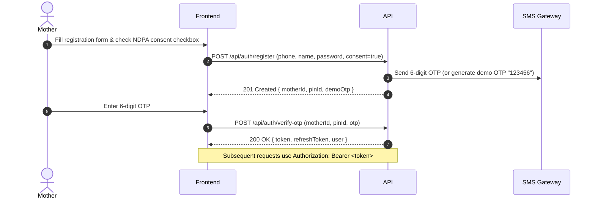
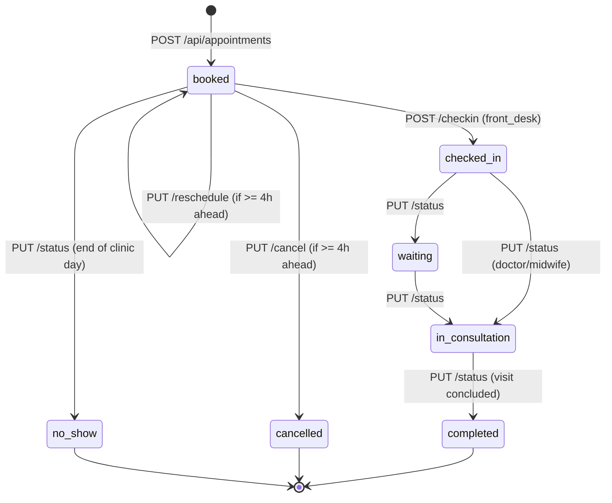

# API Contract: Antenatal & Postnatal Clinic Appointment System

This document specifies the complete API contract for the Antenatal and Postnatal Appointment System backend. All responses, error payloads, status codes, and validation rules in this contract reflect the real running Express + Knex implementation.

---

## 1. Local Setup & Base URL

### How to Run Locally (Windows PowerShell)

```powershell
# 1. Navigate to backend directory
cd backend

# 2. Install dependencies (if not already installed)
npm install

# 3. Environment configuration
# Ensure backend/.env exists with valid DB and JWT configurations (see .env.example)

# 4. Run database migrations
npm run migrate

# 5. Seed initial clinics, staff, and demo slots
npm run seed:demo

# 6. Start the API server
npm start
```

### Base URL & Ports
- **Backend API Base URL**: `http://localhost:5000/api`
- **Health Check Endpoint**: `http://localhost:5000/api/health`
- **CORS Allowed Origins**: Configured via `CORS_ORIGIN` (defaults to `http://localhost:3000`).

---

## 2. Authentication & Authorization

### Header Format
All protected endpoints require an HTTP `Authorization` header containing a JSON Web Token:
```http
Authorization: Bearer <jwt_access_token>
```

### Token Lifecycle & Expiration
- **Access Token Lifetime**: 7 days (default, configurable via `JWT_EXPIRES_IN`). Signed using `JWT_SECRET`.
- **Refresh Token Lifetime**: 30 days (default, configurable via `JWT_REFRESH_EXPIRES_IN`). Signed using dedicated `JWT_REFRESH_SECRET`.

### Mother Registration, OTP & Login Sequence


1. **Mother Registration (`POST /api/auth/register`)**:
   - Requires statutory consent (`consent: true`) per Nigeria Data Protection Act (NDPA) 2023 covering mother and baby data. Returns `motherId`, `pinId`, and `demoOtp` (when in demo SMS mode).
2. **OTP Verification (`POST /api/auth/verify-otp`)**:
   - Submits `motherId`, `pinId`, and `otp`. On success, marks account as verified and returns JWT `token`, `refreshToken`, and user object.
3. **Subsequent Mother Login (`POST /api/auth/login`)**:
   - Mothers log in using phone number and password. Verified mothers receive access and refresh tokens. Unverified mothers receive `403 FORBIDDEN`.

### Staff Authentication
Staff accounts (`front_desk`, `midwife`, `doctor`, `admin`) are pre-seeded or created by an administrator. Staff log in directly via `POST /api/auth/login` using their registered phone number and password. Staff are not subject to SMS OTP or mother consent requirements.

### Refresh Token Flow (`POST /api/auth/refresh-token`)
When an access token expires, clients submit `{ "refreshToken": "<token>" }` to obtain a fresh access token without re-entering credentials.

---

## 3. API Endpoints Reference

### Public & Utility Endpoints

#### `GET /api/health`
- **Role**: Public
- **Description**: Verifies service status and server wall-clock time.
- **Success Response (200 OK)**:
```json
{
  "success": true,
  "message": "Antenatal & Postnatal Appointment System API is running.",
  "timestamp": "2026-11-21T10:45:53.904Z"
}
```

#### `GET /api/clinic-info`
- **Role**: Public
- **Description**: Returns hospital metadata, operating days/hours, emergency unit contact, and Google Maps location link.
- **Success Response (200 OK)**:
```json
{
  "success": true,
  "data": {
    "hospitalName": "General Hospital Lagos / Federal Medical Centre",
    "address": "123 Broad Street, Lagos Island, Lagos State, Nigeria",
    "clinicDaysAndHours": {
      "antenatal": {
        "days": ["Monday", "Wednesday", "Friday"],
        "hours": "08:00 - 12:00",
        "slotDurationMinutes": 20
      },
      "postnatal": {
        "days": ["Tuesday", "Thursday"],
        "hours": "13:00 - 16:00",
        "slotDurationMinutes": 30
      }
    },
    "emergencyUnitNumber": "+2348001122334",
    "googleMapsUrl": "https://maps.google.com/?q=General+Hospital+Lagos+Island+Nigeria"
  }
}
```

#### `GET /api/emergency-notice`
- **Role**: Public
- **Success Response (200 OK)**:
```json
{
  "success": true,
  "message": "For emergencies, please proceed directly to the Emergency Unit. This system is for scheduled clinic visits only."
}
```

---

### Authentication Endpoints (`/api/auth`)

#### `POST /api/auth/register`
- **Role**: Public
- **Body**:
  - `phone` (string, required): Nigerian phone number (e.g. `08012345678` or `+2348012345678`)
  - `name` (string, required): Full name
  - `password` (string, required): Minimum 6 characters
  - `consent` (boolean, required): Must be strictly `true`
  - `hospital_id` (string, optional): Hospital folder/ID number
  - `hmo_number` (string, optional): HMO / NHIA enrollment number
- **Success Response (201 Created)**:
```json
{
  "success": true,
  "message": "Registration successful. Please enter the OTP sent to your phone.",
  "data": {
    "motherId": "b1b7021b-417c-473d-82d0-a0bc5e510825",
    "pinId": "demo-pin-1732185934000",
    "demoOtp": "123456"
  }
}
```
- **Error Codes**: `VALIDATION_ERROR` (422), `CONFLICT` (409).

#### `POST /api/auth/verify-otp`
- **Role**: Public
- **Body**:
  - `motherId` (string/UUID, required)
  - `pinId` (string, required)
  - `otp` (string, required): 6-digit code (e.g. `123456` in demo mode)
- **Success Response (200 OK)**:
```json
{
  "success": true,
  "message": "Phone number verified successfully.",
  "data": {
    "token": "eyJhbGciOiJIUzI1NiIsInR5c...",
    "refreshToken": "eyJhbGciOiJIUzI1NiIsInR5c...",
    "user": {
      "id": "b1b7021b-417c-473d-82d0-a0bc5e510825",
      "name": "Amina Bello",
      "phone": "+2348012345678",
      "role": "mother",
      "is_verified": true
    }
  }
}
```
- **Error Codes**: `VALIDATION_ERROR` (422), `OTP_INVALID` (400), `NOT_FOUND` (404).

#### `POST /api/auth/login`
- **Role**: Public
- **Body**:
  - `phone` (string, required): Registered phone number
  - `password` (string, required)
- **Success Response (200 OK)**:
```json
{
  "success": true,
  "message": "Login successful.",
  "data": {
    "token": "eyJhbGciOiJIUzI1NiIsInR5c...",
    "refreshToken": "eyJhbGciOiJIUzI1NiIsInR5c...",
    "user": {
      "id": "ff3280aa-8a8a-47ee-9706-23ca57c9a2ae",
      "name": "Dr. Adebayo",
      "phone": "+2340000000002",
      "role": "doctor"
    }
  }
}
```
- **Error Codes**: `VALIDATION_ERROR` (422), `UNAUTHORIZED` (401), `FORBIDDEN` (403, unverified mother).

#### `POST /api/auth/refresh-token`
- **Role**: Public
- **Body**:
  - `refreshToken` (string, required)
- **Success Response (200 OK)**:
```json
{
  "success": true,
  "data": {
    "token": "eyJhbGciOiJIUzI1NiIsInR5c..."
  }
}
```
- **Error Codes**: `UNAUTHORIZED` (401).

#### `GET /api/auth/me`
- **Role**: Any Authenticated User
- **Success Response (200 OK)**: Returns the authenticated user's profile and role.

---

### Clinics & Schedule Slots (`/api/clinics`)

#### `GET /api/clinics`
- **Role**: Public
- **Success Response (200 OK)**:
```json
{
  "success": true,
  "data": [
    {
      "id": "ff3280aa-8a8a-47ee-9706-23ca57c9a2ae",
      "name": "Antenatal Clinic",
      "slot_duration_min": 20,
      "walkin_reserve_pct": 0.2
    },
    {
      "id": "7e6ad70c-074e-4276-a97f-9f3922aafa3b",
      "name": "Postnatal Clinic",
      "slot_duration_min": 30,
      "walkin_reserve_pct": 0.2
    }
  ]
}
```

#### `GET /api/clinics/:id/slots?date=YYYY-MM-DD`
- **Role**: Public (Optional Auth: filters walk-ins for mothers/unauthenticated callers)
- **Query**:
  - `date` (string, required): Format `YYYY-MM-DD`
- **Rules**:
  - Unauthenticated and mother callers see **only non-walkin** slots whose start time has not passed in Nigeria (`Africa/Lagos`).
  - Staff (`front_desk`, `admin`, `midwife`, `doctor`) see **both regular and walk-in slots**, and can view today's ongoing slots that have not ended.
  - Queries for past dates return empty available slots list.
- **Success Response (200 OK)**:
```json
{
  "success": true,
  "data": {
    "clinicId": "ff3280aa-8a8a-47ee-9706-23ca57c9a2ae",
    "date": "2026-11-22",
    "availableSlots": [
      {
        "id": "4d6bbb73-4b20-4554-9872-443894aa0a74",
        "start_time": "08:00:00",
        "end_time": "08:20:00",
        "is_walkin": false,
        "staff_id": "9d9d522b-5937-4f8e-8793-b62d24c82dee",
        "staffName": "Dr. Adebayo"
      }
    ],
    "totalAvailable": 1
  }
}
```

---

### Appointments (`/api/appointments`)

#### `POST /api/appointments`
- **Role**: `mother`, `front_desk`, `admin`, `midwife`, `doctor`
- **Body**:
  - `clinic_id` (string/UUID, required)
  - `slot_id` (string/UUID, required)
  - `booking_type` (string, optional): `"mother"`, `"baby"`, or `"both"` (default: `"mother"`)
  - `baby_ids` (array of UUIDs, optional): Required if `booking_type` is `"baby"` or `"both"`
  - `mother_id` (string/UUID, optional): Required when staff books on behalf of a mother; omitted when a mother books for herself
- **Success Response (201 Created)**:
```json
{
  "success": true,
  "message": "Appointment booked successfully.",
  "data": {
    "id": "e8df483f-67d7-4be7-b35f-eb59d9f5aa1a",
    "mother_id": "b1b7021b-417c-473d-82d0-a0bc5e510825",
    "clinic_id": "ff3280aa-8a8a-47ee-9706-23ca57c9a2ae",
    "slot_id": "4d6bbb73-4b20-4554-9872-443894aa0a74",
    "status": "booked",
    "booking_type": "both",
    "booked_at": "2026-11-21T10:30:15.000Z",
    "reminder_24h_sent": false,
    "reminder_2h_sent": false
  }
}
```
- **Error Codes**: `SLOT_PAST` (400), `SLOT_RESERVED` (400), `SLOT_TAKEN` (409), `OVERLAP` (409), `VALIDATION_ERROR` (422).

#### `GET /api/appointments`
- **Role**: Any Authenticated User
- **Query**:
  - `view` (string, optional): `"upcoming"` (default) or `"past"`
  - `status` (string, optional): Filter by explicit appointment status
  - `date` (string, optional): Filter by date (`YYYY-MM-DD`)
  - `clinic_id` (string, optional): Filter by clinic
- **Behavior**:
  - Mothers see only their own appointments.
  - Returns appointment objects including `late_arrival` (boolean, default `false`).
  - `?view=past` returns `completed`, `cancelled`, and `no_show` appointments, ordered newest first.
  - Appointments are **never deleted**; there is no delete endpoint.

#### `GET /api/appointments/:id`
- **Role**: `mother` (ownership enforced), `front_desk`, `midwife`, `doctor`, `admin`
- **Access Rule**: Mothers receive `403 FORBIDDEN` if attempting to view an appointment belonging to another mother.
- **Payload**: Includes full appointment details and `late_arrival: boolean`.

#### `PUT /api/appointments/:id/reschedule`
- **Role**: `mother` (ownership enforced), `front_desk`, `admin`
- **Body**:
  - `new_slot_id` (string/UUID, required)
- **Rules**:
  - Subject to the 4-hour cutoff rule based on `Africa/Lagos` time (`CUTOFF_PASSED`).
  - Cannot reschedule into past slots (`SLOT_PAST`).
  - Mothers cannot reschedule into walk-in slots (`SLOT_RESERVED`).
  - Atomic transfer executed in a single transaction with mother row locking.
- **Success Response (200 OK)**:
```json
{
  "success": true,
  "message": "Appointment rescheduled successfully."
}
```

#### `PUT /api/appointments/:id/cancel`
- **Role**: `mother` (ownership enforced), `front_desk`, `admin`
- **Body**:
  - `reason` (string, optional)
- **Rules**:
  - Subject to 4-hour cutoff rule based on `Africa/Lagos` time (`CUTOFF_PASSED`).
  - Sets `status: "cancelled"`, freeing the slot for other mothers.
- **Success Response (200 OK)**:
```json
{
  "success": true,
  "message": "Appointment cancelled successfully."
}
```

#### `POST /api/appointments/:id/checkin`
- **Role**: `front_desk`, `admin`
- **Behavior & Grace Period Rules**:
  - Allowed on the appointment's scheduled date only (`Africa/Lagos` time) when status is `booked`.
  - Check-in on a different date, or when the appointment is cancelled or already checked in, is refused with `400 CHECKIN_NOT_ALLOWED`.
  - **Grace Period (`LATE_GRACE_MINUTES`, default 15)**:
    - Up to `start_time + grace`: Normal check-in with `late_arrival: false`.
    - After `start_time + grace`: Still accepted, but flagged with `late_arrival: true`.
    - Late mothers join the END of the queue based on their check-in time (`checked_in_at`), never displacing mothers who checked in earlier.
- **Success Response (200 OK)**:
```json
{
  "success": true,
  "message": "Patient checked in.",
  "data": {
    "appointmentId": "e8df483f-67d7-4be7-b35f-eb59d9f5aa1a",
    "queueNumber": "ANC-001",
    "status": "checked_in",
    "checked_in_at": "2026-11-21T10:45:00.000Z",
    "late_arrival": false
  }
}
```
- **Error Codes**: `CHECKIN_NOT_ALLOWED` (400), `NOT_FOUND` (404), `FORBIDDEN` (403), `UNAUTHORIZED` (401).

#### `PUT /api/appointments/:id/status`
- **Role**: `midwife`, `doctor`, `admin`
- **Body**:
  - `status` (string, required): One of `"waiting"`, `"in_consultation"`, `"completed"`, `"no_show"`
- **Rules**:
  - **Marking `no_show`**: Allowed only for appointments never checked in (status must be `booked`), and only after `start_time + LATE_GRACE_MINUTES` has passed in `Africa/Lagos` time. Before that, refused with `400 NO_SHOW_TOO_EARLY`.
  - Appointments already checked in cannot be marked as `no_show` (`400 BAD_REQUEST`).
- **Success Response (200 OK)**:
```json
{
  "success": true,
  "message": "Appointment status updated to completed."
}
```
- **Error Codes**: `NO_SHOW_TOO_EARLY` (400), `BAD_REQUEST` (400), `NOT_FOUND` (404), `FORBIDDEN` (403), `UNAUTHORIZED` (401).

---

### Queue Management (`/api/queue`)

#### `GET /api/queue/today/:clinicId`
- **Role**: Any Authenticated User
- **Privacy Rule**:
  - **Mothers**: Patient names (`mother_name`) are stripped. Returns ticket number, status, timestamp, `late_arrival` flag, and the ticket currently being served.
  - **Staff**: Full queue details including patient names, appointment details, and `late_arrival` flag.
- **Success Response for Mothers (200 OK)**:
```json
{
  "success": true,
  "data": {
    "clinicId": "ff3280aa-8a8a-47ee-9706-23ca57c9a2ae",
    "date": "2026-11-21",
    "queue": [
      {
        "queue_number": "ANC-001",
        "status": "checked_in",
        "checked_in_at": "2026-11-21T10:30:00.000Z",
        "late_arrival": false
      }
    ],
    "totalInQueue": 1,
    "currentlyServing": null
  }
}
```

#### `GET /api/queue/position/:appointmentId`
- **Role**: `mother` (ownership enforced), `front_desk`, `midwife`, `doctor`, `admin`
- **Success Response (200 OK)**:
```json
{
  "success": true,
  "data": {
    "queueNumber": "ANC-001",
    "position": 1,
    "status": "checked_in",
    "late_arrival": false,
    "message": "You are number 1 in the queue."
  }
}
```

---

### Mother & Baby Management (`/api/mothers`, `/api/babies`)

#### `GET /api/mothers/profile` / `PUT /api/mothers/profile`
- **Role**: `mother`
- Read or update mother profile details (name, hospital ID, HMO number).

#### `GET /api/mothers/:id`
- **Role**: `front_desk`, `midwife`, `doctor`, `admin`
- Returns mother profile, babies, and visit history. Audited with action `STAFF_VIEW_MOTHER_PROFILE`.

#### `POST /api/babies` / `GET /api/babies`
- **Role**: `mother` (for her own babies), `front_desk`, `admin`
- Register one or more baby profiles (supports twins/multiples).

---

### Admin Operations (`/api/admin`)

- `GET /api/admin/reports/daily?date=YYYY-MM-DD`: Summary of today's bookings, completions, no-shows, and cancellations.
- `GET /api/admin/reports/appointments`: Comprehensive clinic-level utilization metrics.
- `POST /api/admin/block-date`: Blocks all slots on a specified date (`clinic_id`, `date`, `reason`).
- `POST /api/admin/unblock-date`: Unblocks slots on a date (`clinic_id`, `date`).
- `POST /api/admin/cancel-session`: Cancels an entire clinic session, cancels all active bookings, and dispatches bulk SMS alerts to affected mothers.
- `POST /api/admin/staff`: Creates a new staff account (`name`, `role`, `phone`, `password`).
- `GET /api/admin/audit-logs`: Retrieves system audit logs with filtering by user, action, or date.

---

## 4. Error Response Schema & Error Codes

### Standard Error Response Shape
Every API error response follows this exact structure:

```json
{
  "success": false,
  "error": {
    "code": "SLOT_TAKEN",
    "message": "This slot is already booked. Please choose another."
  },
  "message": "This slot is already booked. Please choose another."
}
```

For validation failures (`422 Unprocessable Entity`), an additional `errors` array is included:
```json
{
  "success": false,
  "error": {
    "code": "VALIDATION_ERROR",
    "message": "Validation failed.",
    "details": [
      { "type": "field", "msg": "Consent is required to register.", "path": "consent", "location": "body" }
    ]
  },
  "message": "Validation failed.",
  "errors": [
    { "type": "field", "msg": "Consent is required to register.", "path": "consent", "location": "body" }
  ]
}
```

### Complete Error Code Table

| Error Code | HTTP Status | Description & Trigger Cause |
|---|---|---|
| `VALIDATION_ERROR` | 422 | Request body or query parameters failed validation checks (e.g. invalid phone format, password too short, missing consent). |
| `UNAUTHORIZED` | 401 | Missing, malformed, or expired JWT bearer token; or invalid login credentials. |
| `FORBIDDEN` | 403 | Authenticated user lacks permission (e.g. mother accessing another mother's appointment, unverified mother login, staff role restriction). |
| `NOT_FOUND` | 404 | Requested route, clinic, slot, mother, baby, or appointment does not exist. |
| `SLOT_TAKEN` | 409 | The slot has already been claimed by another patient (enforced by application lock and DB unique index). |
| `OVERLAP` | 409 | The mother already holds another active appointment during the overlapping time window on that date. |
| `SLOT_RESERVED` | 400 | A mother attempted to book or reschedule into a walk-in reserved slot (`is_walkin: true`). |
| `SLOT_PAST` | 400 | The slot's start time (for mothers) or end time (for staff) has already passed in Nigerian wall-clock time (`Africa/Lagos`). |
| `CUTOFF_PASSED` | 400 | An attempt was made to cancel or reschedule an appointment less than 4 hours before its scheduled start time. |
| `CHECKIN_NOT_ALLOWED` | 400 | Check-in attempted on a date other than the appointment's scheduled date, or appointment is cancelled/already checked in. |
| `NO_SHOW_TOO_EARLY` | 400 | Attempted to mark an appointment as `no_show` before `start_time + LATE_GRACE_MINUTES` has expired. |
| `OTP_INVALID` | 400 | The submitted OTP code is incorrect or has expired. |
| `BAD_REQUEST` | 400 | Generic operational bad request (e.g. attempting to check in an appointment that is not in `"booked"` status). |
| `INTERNAL_SERVER_ERROR` | 500 | Unhandled server error. |

---

## 5. Appointment & Queue Lifecycle Transitions

### Allowed Appointment Statuses
- `booked`: Initial appointment creation.
- `checked_in`: Patient has arrived at the front desk and received a queue ticket.
- `waiting`: Patient is in the waiting area awaiting consultation.
- `in_consultation`: Patient is currently with the midwife or doctor.
- `completed`: Consultation finished.
- `cancelled`: Appointment cancelled by mother or staff (frees the slot).
- `no_show`: Patient did not appear for their scheduled appointment.



### Queue Ticket Statuses
Queue tickets track the clinical waiting area sequence for checked-in appointments:
- `checked_in` -> `waiting` -> `in_consultation` -> `completed`

---

## 6. Clinical Booking Rules

1. **Slot Durations**:
   - **Antenatal Clinic (ANC)**: 20 minutes per slot (operating Monday, Wednesday, Friday: 08:00 - 12:00).
   - **Postnatal Clinic (PNC)**: 30 minutes per slot (operating Tuesday, Thursday: 13:00 - 16:00).
2. **One Patient Per Slot**:
   - Enforced by database partial unique index: `idx_appointments_slot_active ON appointments(slot_id) WHERE status != 'cancelled'`. A cancelled appointment frees the slot immediately.
3. **Walk-In Slot Reservation (20%)**:
   - 20% of slots are marked `is_walkin: true`. These slots are hidden from mother slot queries and rejected if booked by a mother (`SLOT_RESERVED`). Front desk staff can view and book walk-in patients into them.
4. **No Past Slots**:
   - Mothers cannot book or reschedule into any slot whose start time has passed in Nigeria (`Africa/Lagos` UTC+1). Staff can book walk-in slots for today until the slot's end time.
5. **No Overlapping Appointments**:
   - A mother cannot hold two active appointments that overlap in time on the same date, even across different clinics. The mother's record is locked (`forUpdate()`) during booking and rescheduling to serialize concurrent submissions.
6. **4-Hour Reschedule & Cancellation Cutoff**:
   - Patients and staff cannot cancel or reschedule appointments within 4 hours of the slot start time (`CUTOFF_PASSED`).
7. **Late-Arrival Grace Period (`LATE_GRACE_MINUTES`, default 15)**:
   - Check-in is permitted on the appointment's scheduled date only (`Africa/Lagos` time) when status is `booked`. Attempting check-in on any other date or on cancelled/checked-in appointments is refused with `CHECKIN_NOT_ALLOWED`.
   - Up to `start_time + grace_minutes`: normal check-in (`late_arrival: false`).
   - After `start_time + grace_minutes`: check-in is still accepted, but flagged with `late_arrival: true`.
   - Late arrivals join the END of the queue based on their check-in time (`checked_in_at`), never displacing mothers who checked in earlier.
   - Marking `no_show` is permitted only for appointments never checked in (status `booked`), and only after `start_time + grace_minutes`. Attempts prior to grace expiry are refused with `NO_SHOW_TOO_EARLY`.

---

## 7. Seeded Test Accounts & Demo OTP

### Pre-Seeded Accounts
All accounts are seeded with standard passwords documented in the project `README.md` (never exposed via API).

| Role | Name | Phone Number |
|---|---|---|
| `admin` | Admin User | `+2340000000001` |
| `doctor` | Dr. Adebayo | `+2340000000002` |
| `midwife` | Nurse Fatima | `+2340000000003` |
| `front_desk` | Mr. Chukwu | `+2340000000004` |
| `mother` | Mrs. Amina Bello | `+2348012345678` |

### Demo Mode OTP Behavior
When `SMS_API_KEY` is not set or set to `demo`:
- `POST /api/auth/register` and `POST /api/auth/resend-otp` return `demoOtp: "123456"` in the response payload and log to console.
- `POST /api/auth/verify-otp` accepts code `"123456"` for all demo pin IDs.
- SMS confirmations and reminders print simulated SMS cards to the terminal rather than calling the external gateway.

---

## 8. Frontend Implementation Requirements

The backend is intentionally stateless and headless. The frontend application MUST implement the following client-side responsibilities:

1. **Mandatory Consent Checkbox (NDPA 2023)**:
   - Registration forms must present an explicit consent checkbox: *"I consent to the processing of my healthcare data and my baby's data in accordance with the Nigeria Data Protection Act (NDPA) 2023."*
   - The frontend must ensure `consent: true` is included in the registration payload.
2. **Error Code to User Message Mapping**:
   - The frontend must catch structured error codes (`error.code`) and display user-friendly, localized toast/banner messages:
     - `SLOT_TAKEN`: *"Another patient just booked this slot. Please choose another time."*
     - `OVERLAP`: *"You already have an appointment scheduled during this time."*
     - `SLOT_RESERVED`: *"This slot is reserved for hospital walk-in patients."*
     - `SLOT_PAST`: *"This time slot has already passed."*
     - `CUTOFF_PASSED`: *"Appointments cannot be rescheduled or cancelled within 4 hours of start time. Please contact the front desk."*
     - `CHECKIN_NOT_ALLOWED`: *"Check-in is only allowed on the scheduled appointment date for active bookings."*
     - `NO_SHOW_TOO_EARLY`: *"Cannot mark as no-show until the late-arrival grace period (15 minutes) has passed."*
     - `FORBIDDEN`: *"You do not have permission to view or modify this record."*
3. **Queue Polling & Auto-Refresh**:
   - Live waiting room displays and mother queue status screens should poll `GET /api/queue/today/:clinicId` and `GET /api/queue/position/:appointmentId` (recommended interval: 15–30 seconds) or provide a manual "Refresh Queue" control.
4. **Late Badge Indicator**:
   - The frontend must inspect `late_arrival` (boolean) on appointments and queue items.
   - Display a prominent **"Late" badge** next to appointments and waiting room entries where `late_arrival: true` so clinic staff and patients clearly see the patient arrived after their scheduled window.
5. **Token Persistence & Auto-Refresh**:
   - Store the access token in secure client storage (or memory) and the refresh token in an HTTP-only cookie or secure storage.
   - Intercept `401 UNAUTHORIZED` responses, invoke `POST /api/auth/refresh-token`, and replay the failed request.
6. **Timezone Awareness**:
   - The backend runs on Nigeria Standard Time (`Africa/Lagos` UTC+1). The frontend should format dates and countdowns matching Nigerian time regardless of the user's browser device timezone.
